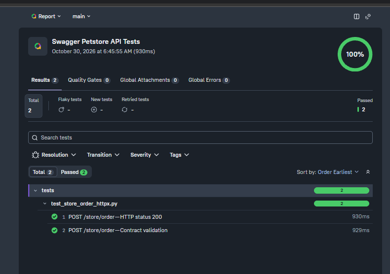

Для полного запуска выполните из корня проекта:

`.\run_tests.cmd`

Сценарий автоматически выполняет два теста, сохраняет результаты в `allure-results/` и генерирует HTML-отчёт в `allure-report/`.

### Просмотр Allure-отчёта

После выполнения сценария откройте отчёт командой:

`allure.cmd open allure-report/awesome`

### Обнаруженное несоответствие

В ответе сервера поле `shipDate` возвращается в формате:

`2026-11-01T12:00:00.000+0000`

Однако документированный формат `date-time` требует соответствия RFC 3339. Корректный вариант записи смещения UTC:

`2026-11-01T12:00:00.000+00:00`

## Скриншоты Allure Report

### Общая статистика

